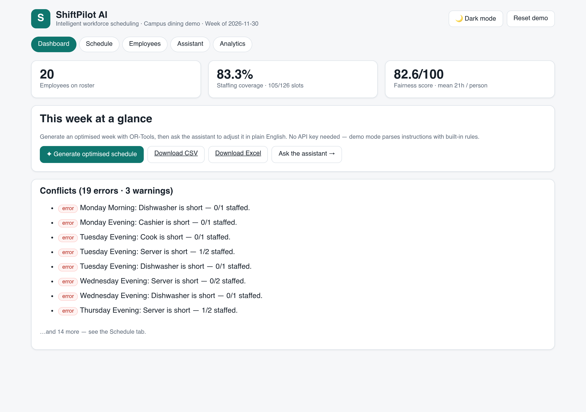
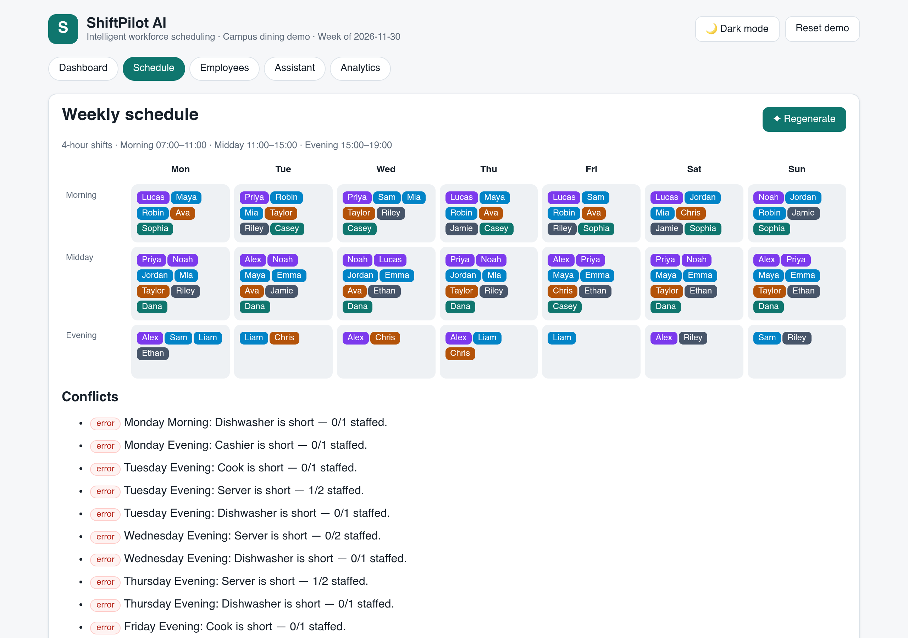
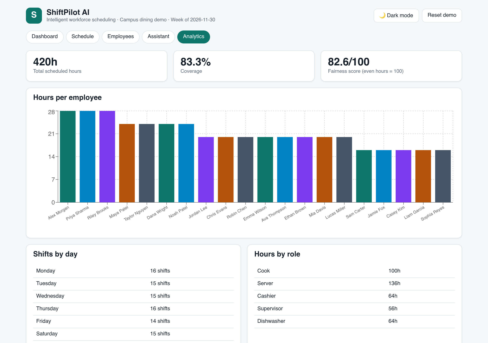
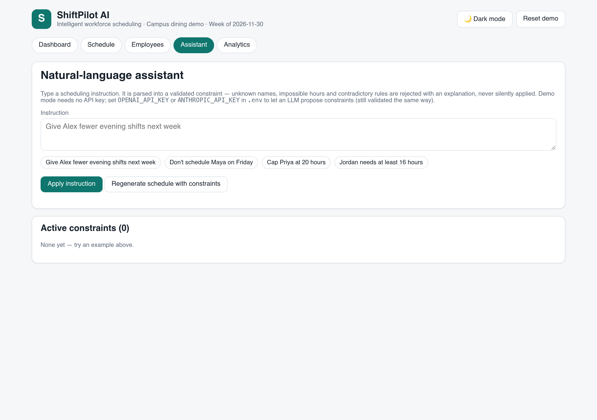
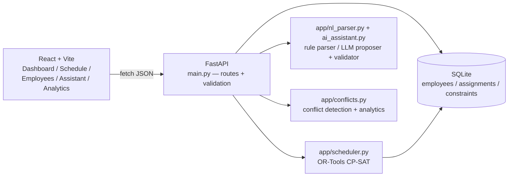

# ShiftPilot AI — Intelligent Workforce Scheduling

An AI-assisted weekly staff scheduler for campus dining, built end to
end as a portfolio project for the **M3 USA AI Engineering Internship**.


## The real-world problem

I spent two years working in Sodexo campus dining at Minot State
University, including as a student manager. Weekly scheduling ran in
Excel: a manager juggling class timetables, hour caps, evening-aversion
and last-minute requests by hand. The failure modes were always the
same — a station short-staffed at lunch, someone scheduled over their
hour cap, and the same reliable people loaded with evenings while
part-timers sat idle.

ShiftPilot replaces the spreadsheet with an optimiser that sees the
whole week at once, a plain-English way to add constraints, and a
check that reports exactly what is still short instead of hiding it.

**Live demo:** https://shiftpilot-ai.onrender.com — free Render tier, no
sign-up, no API key. (The free instance sleeps after ~15 minutes idle,
so the first visit can take up to ~60 seconds to wake up; demo data
resets when the service restarts.)

**All data in this repo is synthetic.** The 20-person roster is
invented (fictional names, `example.edu` emails). No real Sodexo
employee information or confidential workplace data is included.

## Screenshots

Real captures from the live demo (week of 2026-11-30, schedule
generated with OR-Tools CP-SAT: 105/126 slots, 83.3% coverage):

| Dashboard | Weekly schedule |
|---|---|
|  |  |

| Analytics | Natural-language assistant |
|---|---|
|  |  |

## The real-world problem

## Features

- **Employee management** — add, edit and remove employees with role, max weekly hours and per-day/per-shift availability.
- **AI scheduling** — Google OR-Tools CP-SAT generates an optimised week from availability, staffing requirements and constraints. Demo roster: **105 shifts, 83.3% coverage, fairness 83.2/100**.
- **Natural-language assistant** — "Give Alex fewer evening shifts next week" becomes a validated constraint. Works fully with **no API key** (built-in rule parser); with `OPENAI_API_KEY` or `ANTHROPIC_API_KEY` set, an LLM may propose constraints, which pass the *same* validation before being stored.
- **Conflict detection** — understaffing, overtime, double-booking, availability violations, 6+ consecutive days, and evening→next-morning "clopenings".
- **Schedule optimisation** — coverage first, then fairness (minimising the max−min hours spread), then evening-aversion.
- **Employee dashboard** — interactive weekly calendar, colour-coded by role.
- **Analytics dashboard** — hours per employee (Recharts), coverage, fairness score, shifts by day, hours by role.
- **Export** — CSV and Excel (with a per-employee hours sheet).
- **Demo mode** — fully functional without a paid AI key; one-click reset restores the synthetic roster.
- **Dark mode** and responsive layout throughout.

## Tech stack

| Layer | Choice |
|---|---|
| Backend | Python 3.12, FastAPI, SQLAlchemy, Pydantic v2 |
| Optimisation | Google OR-Tools CP-SAT (with a deterministic greedy fallback) |
| AI | Built-in rule parser (demo mode); optional OpenAI / Anthropic proposer, always validated |
| Frontend | React 18, Vite, Recharts |
| Data | SQLite (file-backed; swap via `DATABASE_URL`) |
| Testing / CI | Pytest (22 tests), GitHub Actions |

## Architecture



Key design points: every scheduling rule lives in the backend, so the
API could serve a mobile client without re-implementing anything;
Pydantic validates all writes at the boundary (bad role or a 200-hour
week returns 422 before the scheduler sees it); secrets live only in
`.env`, never in code.

## Installation

**Prerequisites:** Python 3.12+, Node 20+.

```bash
git clone https://github.com/aditya-dudhmal/shiftpilot-ai.git
cd shiftpilot-ai

# Backend
cd backend
python -m venv .venv && source .venv/bin/activate   # Windows: .venv\Scripts\activate
pip install -r requirements.txt
cp ../.env.example ../.env        # optional; demo mode needs no keys
uvicorn app.main:app --reload --port 8000
# API docs: http://localhost:8000/docs

# Frontend (new terminal)
cd frontend
npm install
npm run dev                        # http://localhost:5173
```

The backend seeds the 20-person synthetic roster on first run and
serves the API on port 8000; the Vite dev server proxies `/api` to it.

## API documentation

Base URL: `http://localhost:8000`. Interactive docs at `/docs`.

| Method | Endpoint | What it does |
|---|---|---|
| GET | `/health` | Service status |
| GET | `/api/meta` | Days, shifts, roles, requirements, week start |
| GET / POST | `/api/employees` | List / create employees |
| GET / PUT / DELETE | `/api/employees/{id}` | Read / update / remove one employee |
| POST | `/api/schedules/generate` | Generate the optimised week (OR-Tools, or greedy fallback) |
| GET | `/api/schedules` | Current week's assignments, conflicts, analytics |
| GET | `/api/analytics` | Hours, coverage, fairness |
| GET | `/api/conflicts` | All detected conflicts |
| POST | `/api/assistant/parse` | Parse an English instruction into a validated constraint |
| GET / DELETE | `/api/constraints` | List / deactivate active constraints |
| GET | `/api/export/csv` | Download the schedule as CSV |
| GET | `/api/export/excel` | Download the schedule as Excel |
| POST | `/api/demo/reset` | Restore the synthetic demo roster |

Example:

```bash
curl -X POST localhost:8000/api/assistant/parse \
  -H 'Content-Type: application/json' \
  -d '{"text": "Give Alex fewer evening shifts next week"}'
# {"ok": true, "kind": "limit_evening_shifts", "employee_name": "Alex Morgan",
#  "payload": {"max": 1}, "engine": "rules (demo mode — no API key)", ...}

curl -X POST localhost:8000/api/schedules/generate -H 'Content-Type: application/json' -d '{}'
# {"coverage": 0.833, "solver": "ortools-cp-sat", "assignments": [...], "unfilled": [...]}
```

## Testing

```bash
cd backend
python -m pytest tests/ -q        # 22 tests: scheduler, NL parser, conflicts, API
```

Tests assert the properties that matter: generated schedules never
violate availability, max hours or one-shift-per-day; day-off and
evening-cap constraints are honoured; unknown employees and impossible
hours are rejected, not guessed; and the API round-trips CRUD,
generation and export. GitHub Actions runs the backend tests and the
frontend production build on every push to `main`.

## AI implementation details

The assistant has two layers, and the order matters:

1. **Rule parser** (`backend/app/nl_parser.py`) — deterministic
   matching over a closed vocabulary of constraint kinds, days and
   shifts. Handles day-off, fewer/more evenings, hour caps/floors,
   and avoid/prefer a shift.
2. **Optional LLM proposer** (`backend/app/ai_assistant.py`) — only
   when an API key is set. The prompt requests JSON only, in the
   closed vocabulary. **Whatever the model returns is re-validated**
   by `validate_llm_constraint` (known employee, hours a multiple of
   4 between 4–40, evening cap 0–7, valid day/shift). Invalid
   proposals fall back to the rule parser; an LLM failure never
   fails the request.

The point: an LLM is an untrusted proposer, not a validator. It adds
paraphrase coverage; it never adds authority over the rota.

## Limitations and future improvements

- **Coverage is 83%, not 100%.** Weekly demand is 126 slots; the
  roster can work ~118 shifts. The shortfall is reported as
  understaffing conflicts — a real dining hall would hire or flex
  hours, and the app says so instead of pretending otherwise.
- Fixed 4-hour shifts; no split shifts or variable-length shifts yet.
- No shift swaps between employees, no time-off approval flow, no
  per-employee labour cost.
- SQLite suits a single manager, not concurrent multi-site use
  (Postgres is a one-line `DATABASE_URL` change via SQLAlchemy).
- The rule parser covers common phrasings, not free-form language;
  the LLM path widens that when a key is configured.

## Verified (2026-11-25)

- Fresh virtualenv install from `requirements.txt`: **22/22 pytest
  tests pass**; frontend `npm run build` succeeds.
- Live backend verified with `curl`: `/health` ok, generate returns
  `ortools-cp-sat`, 105 shifts, coverage 0.833; NL parse, CSV and
  Excel export all return 200.
- Live frontend verified in a browser: Dashboard, Schedule,
  Employees, Assistant and Analytics tabs all render with real data.
- **Deployed 2026-11-25 on Render (free tier) at
  https://shiftpilot-ai.onrender.com** — single web service, FastAPI
  serves the built React app. Verified live: 20 employees, schedule
  generates 105/126 shifts (83.3% coverage), fairness 82.6/100,
  analytics charts render. Screenshots above are real captures of
  that deployment. Caveats: free tier sleeps after ~15 min idle
  (first load up to ~60 s); SQLite is ephemeral, so the demo roster
  re-seeds and the schedule resets on restart. The first auto-deploy
  did not trigger (Render missed the push webhook); the deploy was
  started manually from the dashboard — auto-deploy is still set to
  "On Commit" for future pushes.

## AI-assisted development disclosure

This project was built with an AI coding agent (Muse) as the default
workflow, at my direction and under my review — the way the M3 posting
describes: use agentic tools, keep judgement about where they help and
where they quietly produce garbage. Two examples from this build: the
first optimiser objective penalised only the maximum hours, which
scored fairness 4.8/100 until the spread term was added; and the first
staffing requirements asked for 140 slots from a roster that could
work 70. Both were caught by tests and by reading the output, not by
trusting the generator. All code was run, tested and verified locally
before publishing; the synthetic data, architecture decisions and
interview guide are my own work, documented in `INTERVIEW_GUIDE.md`.

## Author

**Aditya Dudhmal** — Computer Science, Minot State University ·
[github.com/aditya-dudhmal](https://github.com/aditya-dudhmal) ·
[linkedin.com/in/adityadudhmal](https://www.linkedin.com/in/adityadudhmal)

Built from two years of lived experience scheduling student workers in
campus dining.
